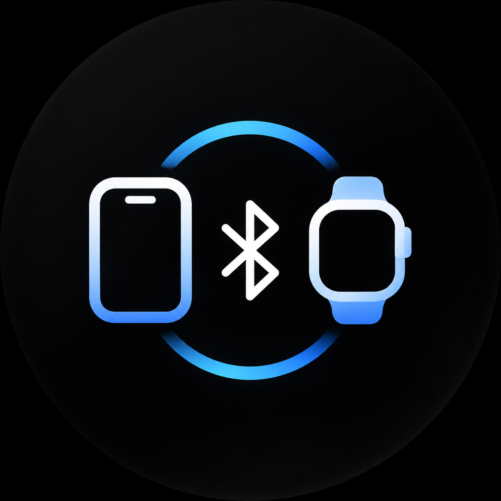
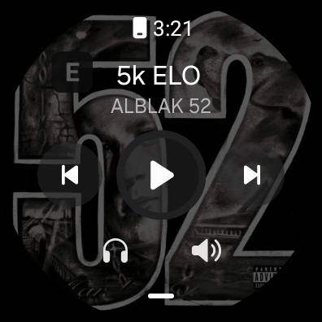

<div align="center">
  
  <h1>WeakBridge — iPhone bridge for Wear OS, with artwork</h1>
  <p>Notifications, app icons and album covers from an iPhone to a Wear OS watch.<br/>No iOS app, no cloud.</p>
  <p><a href="README.ru.md">Русский</a> · <a href="CHANGELOG.md">Changelog</a> · <a href="docs/upstream/README.md">Upstream docs</a></p>
</div>

> [!WARNING]
> **This fork was written by an AI agent (ZCode) and has not been reviewed by a human.**
> It builds, 71 unit tests pass, and every change was verified on a real
> Samsung Galaxy Watch4 Classic (SM-R880, Wear OS 4 / Android 14) paired with an iPhone 15.
> That is not a code review. Treat it as a working prototype: read the diff, keep the upstream
> build, report issues — but do not assume correctness.

Fork of [**Weakmafaka/WeakBridge**](https://github.com/Weakmafaka/WeakBridge) 0.2.0 (MIT).
Upstream mirrors iPhone notifications (ANCS) and playback state (AMS) to a Wear OS watch over plain
Bluetooth LE — no companion app on the iPhone, no cloud relay, no account.

This fork adds the one thing AMS cannot carry — **album artwork** — together with real app icons,
and fixes several bugs that only appear after daily use on a Wi-Fi-only watch.

<div align="center">
  
  
</div>

<p align="center"><em>Left: explicit track on the watch — clean title, <code>E</code> badge, three controls.<br/>
Right: the media status icon with the badge, as drawn by the app.</em></p>

---

## What this fork changes

Everything below is a delta against upstream 0.2.0, listed by file so the diff is easy to audit.
The full commit list is in [CHANGELOG.md](CHANGELOG.md).

### 1. Album artwork — new package `dev.weakbridge.artwork`

Upstream leaves the cover area empty. AMS carries only artist, album, title and duration: Apple
does not send artwork to third-party Bluetooth accessories, so the cover must be resolved on the
watch itself.

| File | Purpose |
|---|---|
| `artwork/ArtworkService.kt` | Pipeline, two-level cache, in-flight deduplication |
| `artwork/RemoteCatalog.kt` | Deezer first, then Apple iTunes (`ru` and `us` storefronts) |
| `artwork/CoverSources.kt` | Local audio files and the watch's media library |
| `artwork/CoverQueue.kt` | Offline queue for tracks heard without a network |
| `artwork/JsonCursor.kt` | ~150-line JSON reader — no new dependency |

Order: local audio → watch media library → Deezer → Apple. Results are cached in memory, on disk
per track **and** per album, so another track from a known album paints with no network at all.
Lookups are serialised: on a fast skip, parallel requests would otherwise race and the card would
end up showing whichever answer arrived last.

**Deezer is the primary source.** The Apple catalog barely indexes Russian releases. Real case:
`Irkutsk Power / ICEGERGERT, OBLADAET` is absent from Apple and resolves from Deezer on the first
query.

### 2. Offline cover queue

The test device is Wi-Fi only, so it is offline most of the time it is being worn. Every track
without a cover is appended to `files/cover_queue.tsv` (title, artist, album — tab separated).
A missing network is *not* recorded as a failure: the track stays queued and is fetched in a single
pass on the next connect. A definitive "no such release" answer does remove the entry.

### 3. Genuinely per-app notification channels

Upstream posts everything into five shared category channels. This fork creates one
`IMPORTANCE_HIGH` channel per iPhone bundle id (`app.swiftgram_ios`, `app.com_apple_mobilesms`, …),
so Wear OS settings show every app as its own row with its own switch and vibration.

Two bugs surfaced here: the old shared channels were never really removed from the system's view,
and one intermediate build doubled the id prefix (`app.app_app_swiftgram_ios`), producing a second
channel per app. Both patterns are purged on start — and only those two.

### 4. Real app icons

- **Status bar:** a silhouette of the App Store icon. The system uses a small icon as an alpha mask
  and tints it, so a full-colour icon collapses into a solid square;
  `NotificationGlyph.silhouette()` maps luminance to alpha and inverts light-background icons.
- **Card body:** the same icon in colour, as the large icon.
- Lookup goes by bundle id with `country=ru`. Without it, a Russian Apple account gets an empty
  result even for apps that exist. The fallback name search accepts only an exact bundle id or a
  name that *starts with* the query — substring matching had returned *Messenger* for *Swiftgram*,
  because both contain "gram".
- Icons are cached in `files/icons/` and survive a restart.

### 5. The explicit-content mark

iOS marks explicit tracks by appending U+20DD (combining enclosing circle) to the title. The watch
font has no glyph for it, so it rendered as an empty box that looked like a broken icon.

This fork strips the character, keeps the fact as a flag, and draws a proper **"E" badge** on the
cover and on the media icon. Position matters: the Samsung media controller draws artwork
full-bleed and centre-crops it to a circle, so the badge sits inside the outer 16% margin.

### 6. Playback position

Upstream reported `PLAYBACK_POSITION_UNKNOWN`, freezing the progress bar for the whole track. Real
position and rate are now passed through, so progress advances and seeking reflects the phone.

### 7. Media card on every surface

`.setShowActionsInCompactView(previous, play/pause, next)` plus a 320 px large icon, so the
collapsed card shows three controls and artwork instead of one button on a grey square.

### 8. Volume — not working

AMS offers only relative "volume up" / "volume down". Upstream registered a *relative* provider,
which the watch's media controller largely ignored. This fork registers an **absolute** provider
over a 16-step local scale and translates a slider move into that many relative commands.

**Status: unverified and reported broken.** The provider is registered correctly
(`controlType=ABSOLUTE, max=16`), but volume could not be exercised without touch: the hardware has
no volume buttons and the controller's slider cannot be driven over adb. The user reports it still
does not work. Do not treat it as functional.

### 9. Debug and repair entry points

`ensureChannel`, `drainQueue`, `queuedCount`, `online()`, and a one-command connect for an
already-paired phone — aiming at a list row on a 396 px screen was not practical during testing.

---

## Verified on hardware

| Check | Result |
|---|---|
| Pairing with iPhone 15 | `Connected`, notifications `Ready`, music `Ready` |
| Cover for a Russian track | 500×500 resolved via Deezer, cached on disk |
| Cover for an unseen album | queued in `cover_queue.tsv`, filled when the network returns |
| Explicit track | title clean, `E` badge visible on the watch |
| App icon | `icon=Icon(typ=BITMAP size=96x96)` in the notification record |
| Channels | only `bridge`, `media`, `app.swiftgram_ios`… remain active |
| Volume | **not working** |
| Samsung media widget | controls work, cover stays blank |

Unit tests: 71, all passing (`./gradlew :app:testDebugUnitTest`).

---

## Build

Requires **JDK 17**, **Android SDK 35** and Build Tools 35.0.0.

```sh
echo "sdk.dir=/path/to/android-sdk" > local.properties
./gradlew :app:assembleWear :app:testDebugUnitTest
# app/build/outputs/apk/wear/app-wear.apk
```

The signing key is yours, so this build replaces the upstream app rather than installing beside it.
`INSTALL_FAILED_UPDATE_INCOMPATIBLE` means the old package must be uninstalled first.

## Install

Enable developer options and wireless debugging on the watch:

```sh
adb pair <IP>:<PAIRING_PORT>
adb connect <IP>:<DEBUG_PORT>
adb install -r app/build/outputs/apk/wear/app-wear.apk
```

Open WeakBridge, allow **Nearby devices** and **Notifications**, then **Connection → Connect iPhone**
and confirm the pairing prompt on both devices. iOS shares notifications only with a bonded
accessory that has system-notification sharing enabled.

## Limits — none of these are bugs to report

- **Artwork for a track that has never played, while offline, is impossible.** Apple does not send
  it and the Yandex Music offline cache holds encrypted ExoPlayer chunks with no readable audio or
  tags (verified by inspecting the files). With no network there is no source.
- **The Samsung media *widget* keeps a blank cover.** Its controls work; only the image is missing.
  The system controller reads `ALBUM_ART` but expects a media3 session, while this app exposes a
  compat wrapper. Fixing it means porting the media session to media3 — not attempted here.
- **No message replies.** ANCS can only press actions the sender declared.
- **No Apple Health export.** HealthKit accepts data only from an app on the iPhone, so this needs a
  separate Swift companion rather than a change on the watch.

## Licence

MIT, inherited from upstream. See [LICENSE](LICENSE) and
[THIRD_PARTY_NOTICES.md](THIRD_PARTY_NOTICES.md).
Upstream copyright: Copyright (c) 2026 Weakmafaka. Changes in this fork: 2026, AI agent.

## Upstream references

- [Weakmafaka/WeakBridge](https://github.com/Weakmafaka/WeakBridge)
- [Apple Notification Center Service](https://developer.apple.com/library/archive/documentation/CoreBluetooth/Reference/AppleNotificationCenterServiceSpecification/Specification/Specification.html)
- [Apple Media Service](https://developer.apple.com/library/archive/documentation/CoreBluetooth/Reference/AppleMediaService_Reference/Specification/Specification.html)
