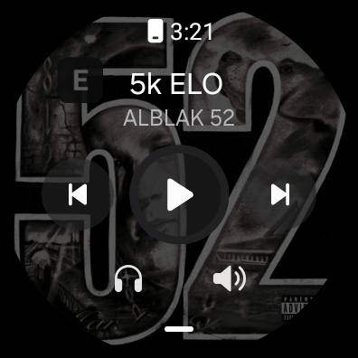

# WeakBridge — мост iPhone для Wear OS, с обложками

[English version →](README.md)

> **Этот форк написан ИИ-агентом (ZCode) и не проходил код-ревью человеком.**
> Он собирается, юнит-тесты проходят, и каждое изменение ниже проверено на реальных
> Samsung Galaxy Watch4 Classic (SM-R880, Wear OS 4 / Android 14) в паре с iPhone 15.
> Но это не то же самое, что ревью: относитесь к сборке как к рабочему прототипу,
> читайте дифф и держите под рукой оригинальную сборку. Багрепорты — да, слепое доверие — нет.

Форк [**Weakmafaka/WeakBridge**](https://github.com/Weakmafaka/WeakBridge) версии 0.2.0 (MIT).
Оригинал передаёт уведомления iPhone (ANCS) и состояние плеера (AMS) на часы Wear OS по
обычному Bluetooth LE — без приложения на iPhone и без облака.

Этот форк существует ради одной вещи: **обложки треков и настоящие иконки приложений**, которых
в оригинале нет, плюс исправление нескольких багов, вылезших при ежедневном использовании на
часах с одним Wi-Fi.

<div align="center">
  
  
</div>

<p align="center"><em>Слева: explicit-трек на часах — чистое название, бейдж <code>E</code>, три кнопки.<br/>
Справа: иконка плеера в статус-баре с бейджем.</em></p>

Навигация: [что изменено](#что-изменено-относительно-оригинала) ·
[сборка](#сборка) · [установка](#установка) · [ограничения](#ограничения--и-это-не-баги)

---

## Что изменено относительно оригинала

Всё перечислено по файлам, чтобы дифф было легко проверить.

### 1. Обложки треков (новый пакет `dev.weakbridge.artwork`)

В оригинале на месте обложки пусто. AMS передаёт только исполнителя, альбом, название и
длительность — Apple не отдаёт артворк сторонним Bluetooth-устройствам, поэтому обложку
приходится искать на самих часах.

| Файл | Что делает |
|---|---|
| `artwork/ArtworkService.kt` | Пайплайн поиска, двухуровневый кэш, защита от дублей |
| `artwork/RemoteCatalog.kt` | Сначала Deezer, потом Apple iTunes (витрины `ru` и `us`) |
| `artwork/CoverSources.kt` | Локальные аудиофайлы и медиатека часов |
| `artwork/CoverQueue.kt` | Оффлайн-очередь: треки, услышанные без сети |
| `artwork/JsonCursor.kt` | Читатель JSON на ~150 строк (новая зависимость не добавлялась) |

Порядок поиска: локальные файлы → медиатека часов → Deezer → Apple. Результат кэшируется в
памяти, на диске по треку **и по альбому**, поэтому трек из уже известного альбома показывается
без сети вообще. Запросы сериализованы: при быстром переключении иначе улетает несколько
запросов и карточка показывает ответ, пришедший последним.

**Deezer — основной источник**, потому что каталог Apple почти не индексирует российские
релизы. Реальный пример: `Irkutsk Power / ICEGERGERT, OBLADAET` в Apple не находится, а Deezer
отдаёт с первого запроса.

### 2. Оффлайн-очередь обложек

Тестовое устройство работает только по Wi-Fi, то есть большую часть времени оно без сети.
Каждый трек без обложки дописывается в `files/cover_queue.tsv` (название, исполнитель, альбом
через табуляцию). Отсутствие сети **не считается провалом** — трек остаётся в очереди и
догружается одним проходом при следующем подключении. А вот окончательный ответ каталога
«такого релиза нет» запись удаляет.

### 3. Каналы уведомлений — реально раздельные

Оригинал сваливает всё в пять общих каналов по категориям. Здесь на каждый bundle id
создаётся свой канал `IMPORTANCE_HIGH` (`app.swiftgram_ios`, `app.com_apple_mobilesms`, …),
поэтому в настройках Wear OS каждое приложение — отдельная строка со своим выключателем и
своей вибрацией.

Попутно нашлись два бага: старые общие каналы никогда не удалялись по-настоящему, а одна из
промежуточных сборок удваивала префикс id (`app.app_app_swiftgram_ios`), из-за чего на
приложение появлялся второй канал. Теперь при старте удаляются ровно эти два шаблона и ничего
больше.

### 4. Настоящие иконки приложений

- **Статус-бар:** силуэт иконки из App Store. Система использует маленькую иконку как маску
  по альфе и перекрашивает её, поэтому полноцветная иконка превращается в сплошной квадрат.
  `NotificationGlyph.silhouette()` переводит яркость в альфу и инвертирует светлые иконки.
- **Тело карточки:** та же иконка в цвете как large icon.
- Поиск идёт по bundle id с `country=ru` (без него российский аккаунт Apple получает пустой
  ответ даже для существующих приложений), затем поиском по имени, который принимает только
  точный bundle id или имя, **начинающееся** с запроса. Сравнение по подстроке до этого
  находило *Messenger* по запросу *Swiftgram* — общее «gram».
- Все иконки кэшируются в `files/icons/` и переживают перезапуск.

### 5. Метка explicit

iOS помечает explicit-треки, добавляя в конец названия U+20DD (combining enclosing circle).
В шрифте часов глифа нет, поэтому рисовался пустой квадрат — выглядел как сломанная иконка.

Форк вырезает символ, запоминает факт в отдельном флаге и рисует нормальный **бейдж «E»** на
обложке и на иконке плеера. Позиция важна: Samsung-контроллер растягивает обложку на весь
экран и обрезает по кругу, поэтому бейдж сдвинут внутрь от края на 16% — иначе его срезает.

### 6. Позиция воспроизведения

Оригинал отдавал `PLAYBACK_POSITION_UNKNOWN`, из-за чего полоса прогресса стояла на весь трек.
Теперь передаются реальная позиция и скорость, прогресс идёт, перемотка отражается.

### 7. Карточка плеера на всех поверхностях

`.setShowActionsInCompactView(назад, play/pause, вперёд)` и large icon 320 px — свёрнутая
карточка показывает три кнопки и обложку вместо одной кнопки на сером квадрате.

### 8. Громкость (не работает)

AMS умеет только относительные «громче»/«тише». Оригинал регистрировал *относительный*
провайдер, который медиаконтроллер часов по большей части игнорировал. Здесь регистрируется
**абсолютный** провайдер на локальной шкале из 16 шагов, а движение ползунка переводится в
нужное число относительных команд.

**Статус: не проверено / не работает.** Провайдер зарегистрирован корректно
(`controlType=ABSOLUTE, max=16`), но проверить громкость без касаний не получилось: кнопок
громкости на железе нет, а ползунок контроллера нельзя подвинуть через adb. Пользователь
сообщил, что не работает. Не считайте это рабочей функцией.

### 9. Отладочные точки входа

`ensureChannel`, `drainQueue`, `queuedCount`, `online()` и подключение уже спаренного телефона
одной командой — чтобы не целиться пальцем в строку списка на экране 396 px.

---

## Проверено на железе

| Проверка | Результат |
|---|---|
| Подключение к iPhone 15 | `Connected`, уведомления `Ready`, музыка `Ready` |
| Обложка российского трека | 500×500 найдена через Deezer, лежит в кэше |
| Обложка для нового альбома | попадает в `cover_queue.tsv`, догружается после появления сети |
| Explicit-трек | название чистое, бейдж `E` виден на часах |
| Иконка приложения | `icon=Icon(typ=BITMAP size=96x96)` в записи уведомления |
| Каналы | активны только `bridge`, `media`, `app.swiftgram_ios`… |
| Громкость | **не работает** |

Юнит-тесты: 71, все проходят (`./gradlew :app:testDebugUnitTest`).

---

## Сборка

Нужны **JDK 17**, **Android SDK 35** и Build Tools 35.0.0.

```sh
echo "sdk.dir=/путь/к/android-sdk" > local.properties
./gradlew :app:assembleWear :app:testDebugUnitTest
# app/build/outputs/apk/wear/app-wear.apk
```

Ключ подписи ваш, поэтому эта сборка заменяет оригинальное приложение, а не ставится рядом
(`INSTALL_FAILED_UPDATE_INCOMPATIBLE` означает, что сначала нужно удалить старое).

## Установка

Включите на часах параметры разработчика и отладку по Wi-Fi, затем:

```sh
adb pair <IP>:<PAIRING_PORT>
adb connect <IP>:<DEBUG_PORT>
adb install -r app/build/outputs/apk/wear/app-wear.apk
```

Откройте WeakBridge, разрешите **Устройства поблизости** и **Уведомления**, затем
**Подключение → Подключить iPhone** и подтвердите код на обоих устройствах. iOS делится
уведомлениями только со спаренным устройством, у которого включён общий доступ к системным
уведомлениям.

## Ограничения — и это не баги

- **Обложка для трека, который ещё не играл и сети нет — невозможна.** Apple её не отдаёт, а
  оффлайн-кэш Яндекс.Музыки состоит из зашифрованных чанков ExoPlayer без читаемого аудио и
  тегов (проверено вскрытием файлов). Без сети источника просто нет.
- **Системный виджет Samsung остаётся без обложки.** Средства управления в нём работают, но
  картинку он не показывает: системный контроллер читает `ALBUM_ART`, однако ждёт сессию
  media3, а приложение отдаёт compat-обёртку. Починка означает перенос медиа-сессии на media3,
  за это я не брался.
- **Ответов на сообщения нет.** ANCS умеет только нажимать действия, объявленные отправителем.
- **Выгрузки в Apple Health нет.** HealthKit принимает данные только от приложения на самом
  iPhone, поэтому нужен отдельный Swift-компаньон, а не правка на часах.

## Лицензия

MIT, унаследована от оригинала. См. [LICENSE](LICENSE) и
[THIRD_PARTY_NOTICES.md](THIRD_PARTY_NOTICES.md).
Копирайт оригинала: Copyright (c) 2026 Weakmafaka. Изменения этого форка: 2026, ИИ-агент.

## Оригинал

- [Weakmafaka/WeakBridge](https://github.com/Weakmafaka/WeakBridge) — проект, на котором всё основано
- [Apple Notification Center Service](https://developer.apple.com/library/archive/documentation/CoreBluetooth/Reference/AppleNotificationCenterServiceSpecification/Specification/Specification.html)
- [Apple Media Service](https://developer.apple.com/library/archive/documentation/CoreBluetooth/Reference/AppleMediaService_Reference/Specification/Specification.html)
