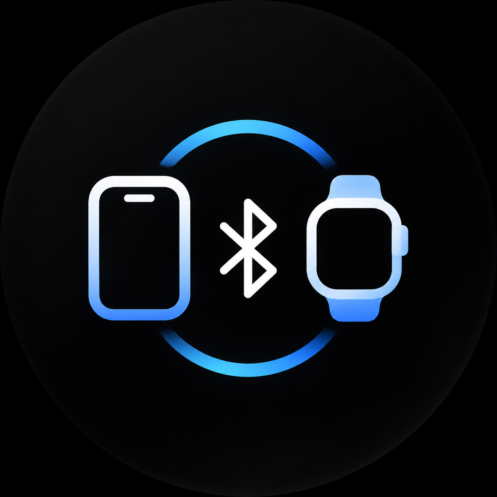
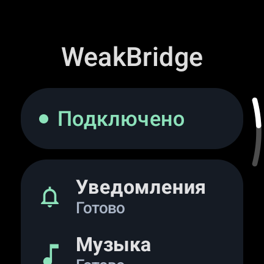
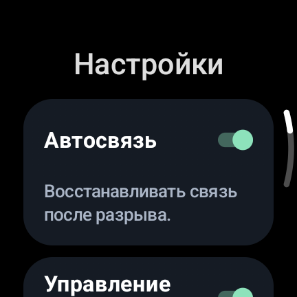
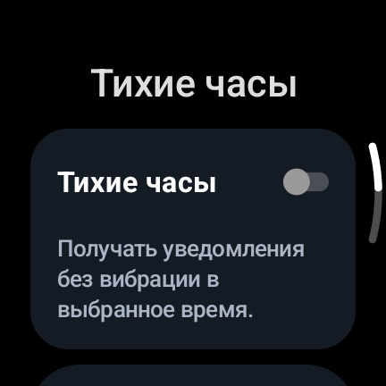

<div align="center">
  
  <h1>WeakBridge</h1>
  <p>Уведомления и управление музыкой с iPhone — на Galaxy Watch.</p>
  <p><a href="https://github.com/Weakmafaka/WeakBridge/releases/latest">Скачать APK</a> · <a href="../README.md">English</a> · <a href="https://github.com/Weakmafaka/WeakBridge/issues">Сообщить об ошибке</a></p>
</div>

WeakBridge — открытый Bluetooth-мост для подключения Samsung Galaxy Watch на Wear OS к iPhone: уведомления iOS и управление музыкой на часах. Устанавливается одно приложение на часы; приложение на iPhone, аккаунт и облачный сервер не нужны. Звук остаётся на телефоне или выбранных на нём наушниках. Уведомления ANCS и управление музыкой AMS используют встроенные Bluetooth-сервисы Apple.

<p align="center">
  
  
  
</p>

Скриншоты с Galaxy Watch6. Интерфейс доступен на русском и английском.

[Сайт проекта и FAQ](https://weakmafaka.github.io/WeakBridge/ru/) · [English](https://weakmafaka.github.io/WeakBridge/)

## Возможности

- Новые уведомления iPhone, их обновление, удаление и действия, предоставленные iOS.
- Фильтры категорий и приложений, группировка, скрытие текста, тихие часы и ограничение повторных сигналов.
- Название трека, исполнитель, воспроизведение/пауза, следующий и предыдущий трек, относительная громкость через системный плеер часов.
- Работа после закрытия экрана приложения и ограниченное автоматическое восстановление связи.
- Раздельные состояния уведомлений и музыки, локальная диагностика с копированием и очисткой.

В 0.2.0 переработан интерфейс, добавлены настройки уведомлений и устранена лишняя работа Bluetooth. Обычные настройки применяются без переподключения. [Список изменений](../CHANGELOG.md).

## Совместимость

**Бета, проверена на Galaxy Watch6 SM-R930 с iPhone 13 / iOS 26.0.** На этом комплекте подтверждены сопряжение, управление музыкой, новые экраны и обычная работа. Другие модели, прошивки и музыкальные приложения требуют проверки. Длительных замеров батареи пока нет.

| Что известно | Устройство или требование |
|---|---|
| Проверенный комплект | Samsung Galaxy Watch6 (SM-R930), iPhone 13, iOS 26.0 |
| Минимум для часов | Уже настроенные Wear OS-часы с Android 13 / API 33+ |
| Другие устройства и приложения | Нужна отдельная проверка модели, прошивки и плеера |

Нужны уже настроенные часы с Android 13 / API 33 или новее. WeakBridge не заменяет Galaxy Wearable и первоначальную настройку часов. Передачи звука, синхронизации здоровья и произвольных ответов на сообщения нет. Действия уведомлений определяет iOS. Доступность жестов зависит от прошивки; приложение не добавляет двойной щипок в AOD или глобальную паузу сжатием кулака.

## Установка

1. Скачайте `WeakBridge-0.2.0.apk` из [последнего релиза](https://github.com/Weakmafaka/WeakBridge/releases/latest).
2. Включите параметры разработчика и беспроводную отладку на часах. Подключите часы и компьютер к одной сети Wi-Fi.
3. Подставьте адреса и порты с экрана часов:

```sh
adb pair WATCH_IP:PAIRING_PORT
adb connect WATCH_IP:DEBUG_PORT
adb install -r WeakBridge-0.2.0.apk
```

Порт сопряжения и порт подключения отличаются. После установки выключите беспроводную отладку. В релизе приложен `SHA256SUMS.txt` для проверки APK.

**Обновление публичной 0.1.4:** команда `adb install -r` сохранит настройки. Ключ подписи прежний.

**Переход с приватной тестовой сборки:** у неё другой ключ. При `INSTALL_FAILED_UPDATE_INCOMPATIBLE` переход на публичный APK потребует удаления приватного приложения со сбросом его настроек. Bluetooth-сопряжение можно оставить; после установки снова выберите iPhone.

## Как подключить Samsung Galaxy Watch к iPhone

1. Откройте WeakBridge и разрешите доступ к устройствам поблизости и уведомлениям.
2. Откройте **«Подключение» → «Подключить iPhone»** и подтвердите системный запрос видимости на две минуты.
3. На iPhone откройте **Настройки → Bluetooth**, выберите часы и подтвердите совпадающие коды на обоих устройствах.
4. Разрешите обмен уведомлениями. Если в Bluetooth-настройках часов на iPhone есть **«Делиться системными уведомлениями»**, включите его.
5. В разделе **«Подключение»** на часах откройте список сохранённых устройств и выберите свой iPhone. Для выбранного телефона есть **«Подключить снова»**.
6. Отправьте новое уведомление и запустите музыку для проверки двух сервисов.

Название часов в Bluetooth не меняется. Дополнительный поиск совместимых устройств не заменяет сопряжение: пустой список ещё не означает несовместимость iPhone.

## Настройки уведомлений

Откройте **Настройки → Уведомления**. Приложения появятся в списке после первого полученного уведомления. Можно отключать отдельные источники и категории, группировать сообщения и скрывать их текст.

Тихие часы используют время часов и подавляют сигнал, сохраняя сами сообщения. Одинаковое начало и окончание означают тишину весь день. «Повторные сигналы» задают минимальный интервал между оповещениями одного приложения; обновления существующих карточек проходят тихо.

## Если что-то не работает

- **Не видно часов:** снова откройте двухминутное окно видимости и подтвердите системный запрос.
- **Разрешения есть, сервис недоступен:** проверьте, что выбран именно iPhone. Разрешения Android и доступ к ANCS/AMS на телефоне — разные состояния.
- **Нет уведомлений:** проверьте обмен системными уведомлениями, разрешения приложения на iPhone, превью и фокусирование. Отправьте новое сообщение: старые события при подключении пропускаются.
- **Нет плеера:** начните воспроизведение на iPhone и проверьте «Управление музыкой». Работа системного плеера зависит от Samsung и музыкального приложения.

При повторяющейся проблеме [создайте issue](https://github.com/Weakmafaka/WeakBridge/issues/new/choose). Укажите модели, ОС и шаги воспроизведения; удалите личные данные из приложений к отчёту.

## Частые вопросы

**Можно ли подключить Galaxy Watch6 к iPhone?** Да, WeakBridge проверен на Watch6 SM-R930 с iPhone 13 / iOS 26.0. Он добавляет уведомления и управление музыкой, но не заменяет полный набор Galaxy Wearable на iOS.

**Нужно ли приложение на iPhone?** Нет. Один APK на часах использует встроенные сервисы Apple Notification Center Service (ANCS) и Apple Media Service (AMS) по Bluetooth.

**Можно ли настроить сброшенные часы только с iPhone?** Нет. Часы должны быть уже настроены и работать на Android 13 / API 33 или новее. Другие Wear OS-модели пока требуют отдельной проверки.

## Данные и батарея

Нет Интернета, аналитики и сервера. Тексты и наблюдавшиеся имена приложений остаются в оперативной памяти и системных уведомлениях Android. История переписки не сохраняется. На диске — настройки, заблокированные идентификаторы приложений и выбранное Bluetooth-устройство.

Постоянного сканирования, опроса телефона и wake lock нет. В 0.2.0 сокращены ненужные операции, но процент экономии не измерен. [Устройство BLE-связи и методика батарейной проверки](../BATTERY_OPTIMIZATION.md). Фактический расход при ограниченных попытках восстановления и режиме LOW_POWER ещё нужно измерить.

## Разработка

[Сборка](../README.md#build), [архитектура](../ARCHITECTURE.md), [проверки](../TESTING.md). Лицензия — [MIT](../LICENSE).

Если приложение полезно, поставьте звезду репозиторию — так другим владельцам часов будет проще его найти.
